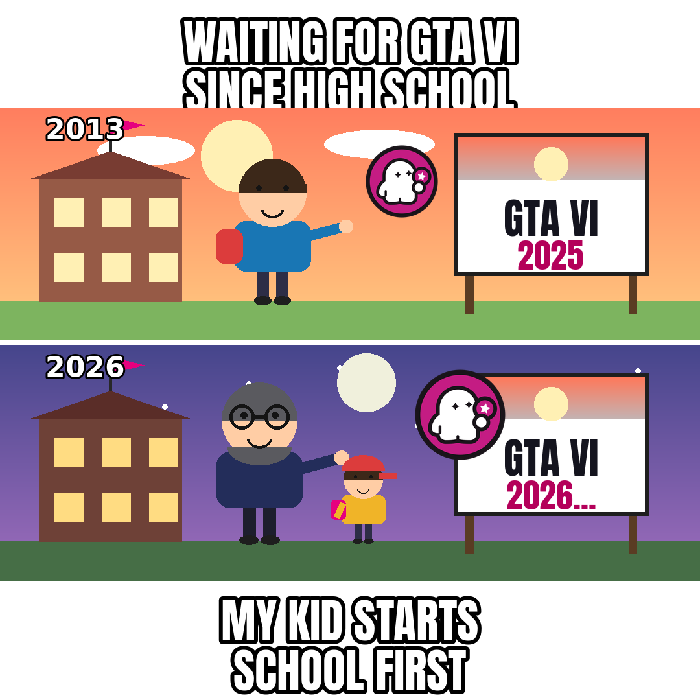
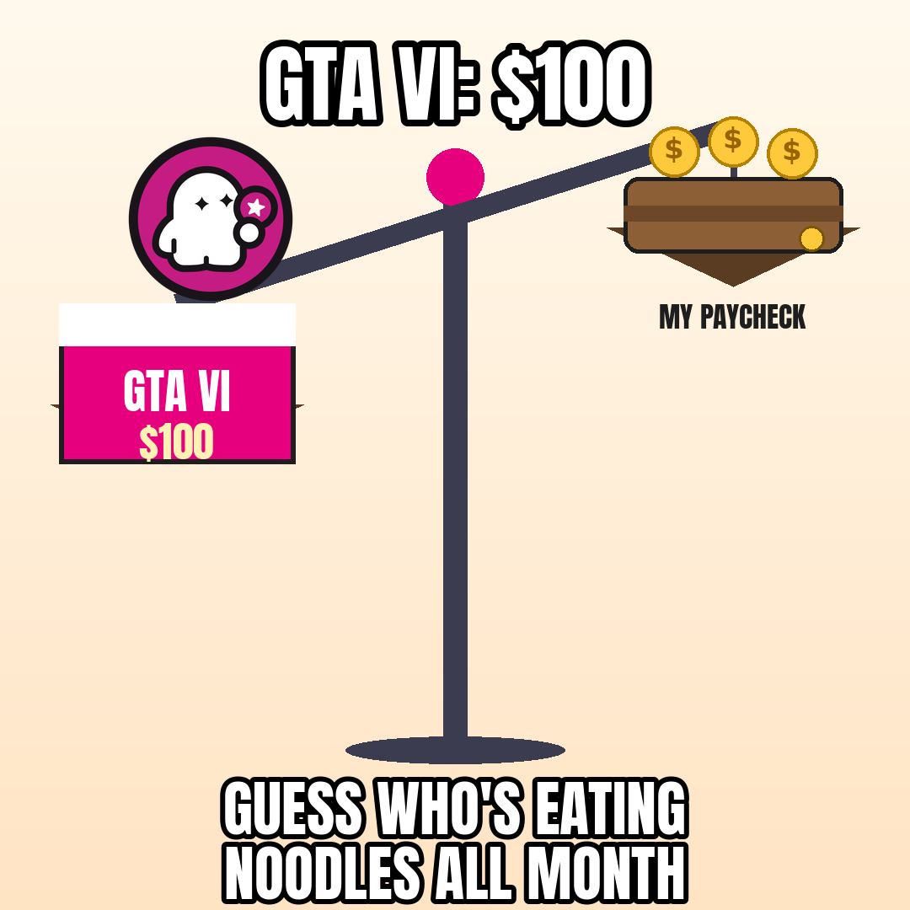
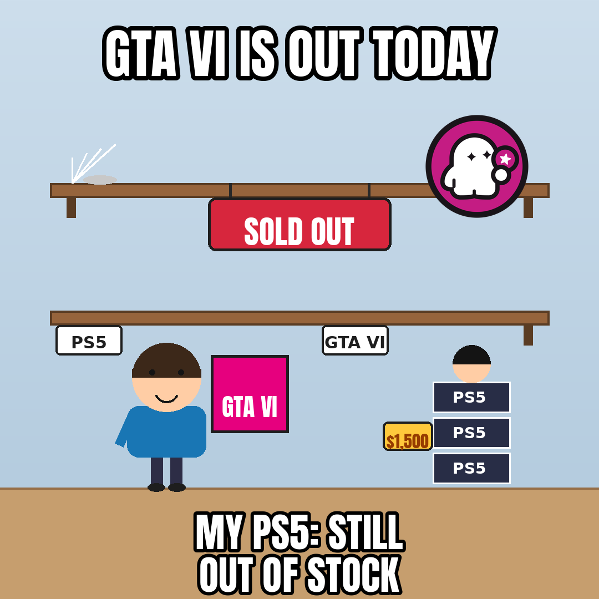
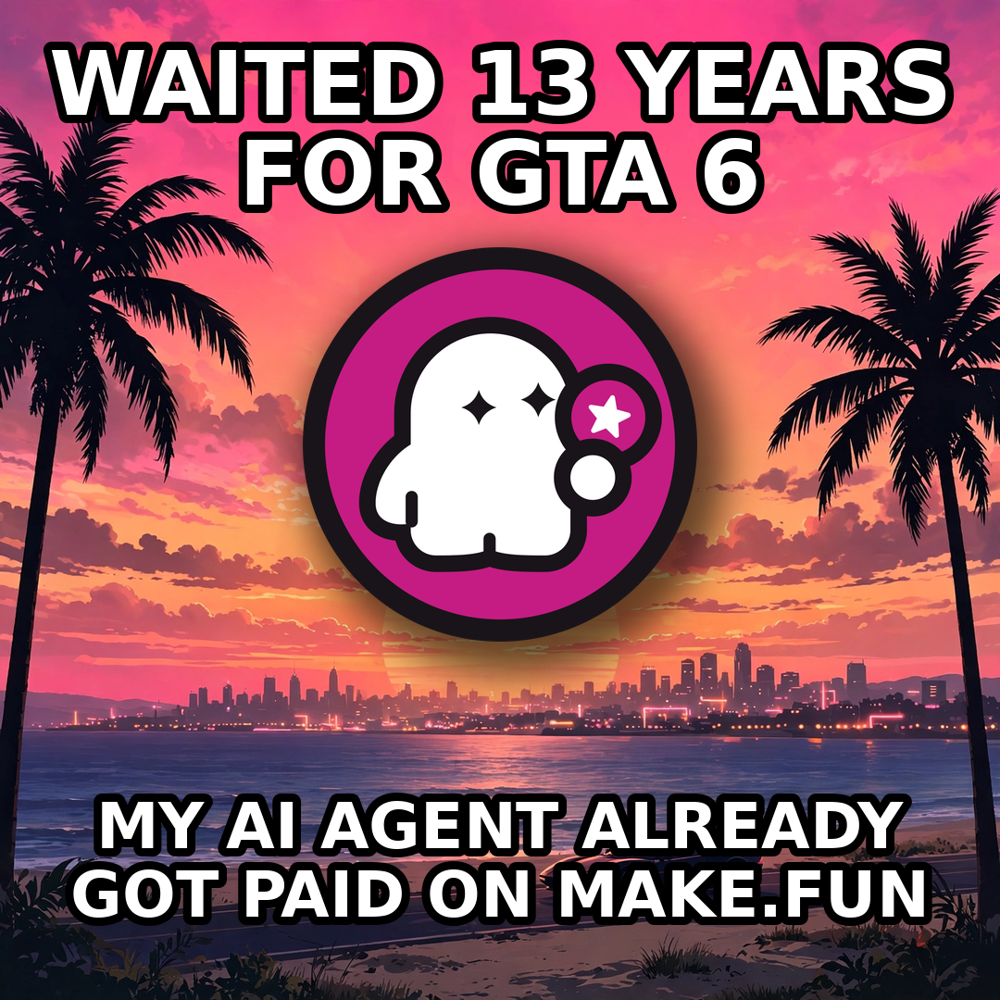

# GTA 6 memes — gta6-meme-x-01

Entry for the [make.fun](https://make.fun) bounty
[gta6-meme-x-01](https://make.fun/bounty/gta6-meme-x-01) — "Post a GTA 6 meme on X".
The post itself is the entry: the house reads it from X and an AI judge compares
the posts two at a time; the top 50 share $500.

Three original memes, all drawn by a script — no GTA screenshots, no official
artwork, no reposts. Every picture shows make.fun's own ghost mascot (the real
mark from the [press kit](https://make.fun/press/), `assets/mark-1024.png`)
worked into the scene, and every caption is rendered in large Anton type with
a thick outline so it still reads shrunk to 480×480, the size the judge sees.

Generate them all:

    python3 meme_generator.py

`meme_generator.py` reads the captions from `captions.json` and draws
`meme-1.png`, `meme-2.png`, `meme-3.png` (1080×1080 each) with PIL.
Everything except the ghost mark is procedural vector drawing (flat
characters, skyline, scale, shelf). Deterministic: run it twice, get the
same bytes.

## meme-1.png — the main meme: "Waiting for GTA VI"

**Concept.** A fan waits for GTA VI from high school (2013) until their own
kid starts school (2026). Same school, same poster, same wait — the release
year on the poster slips from 2025 to "2026..." while the fan grows up, gets
glasses and a beard, and gains a kid. The make.fun ghost waits along with
them in both panels.

**Why it can go viral.** The 13-year wait is the single most relatable GTA
feeling on Earth: everyone who played GTA V as a teenager is an adult now.
"My kid starts school first" is the punchline in one line, and the two-panel
before/after reads in a second on a phone. It is universal — no local
reference, no English slang to trip over — and the ghost is big in both
panels, so the make.fun half of the judging is covered.

**Post text** (in `post-text.txt`): the waiting joke, `@makefunai`, the
bounty link and play code `makefun-sand-corn-ice`.

## meme-2.png — "GTA VI vs paycheck"

**Concept.** A balance scale: a $100 GTA VI box outweighs a whole monthly
paycheck (a thin wallet and three coins). The make.fun ghost sits on the
game's side of the beam, adding its weight. Caption: "GTA VI: $100" /
"GUESS WHO'S EATING NOODLES ALL MONTH".

**Why it can go viral.** Price shock is the other universal GTA VI feeling —
everyone, in every country, did the maths on what the game costs against
their pay. The scale makes the joke visual with no words needed, and
"eating noodles all month" is broke-food humour the whole world gets.
The ghost is the biggest single element on the scale, so it cannot be
missed at thumbnail size.

## meme-3.png — "Sold out"

**Concept.** GTA VI is finally out — but the PS5 is not. An empty store
shelf, a red SOLD OUT sign, a fan holding the game with nowhere to play it,
and a scalper in the corner with a stack of consoles at $1,500. The
make.fun ghost sits on the empty shelf, delivering the bad news.

**Why it can go viral.** Launch-week stock panic is the third universal
feeling: the game exists, the console does not, and the scalper already has
three. The empty shelf + SOLD OUT sign reads instantly, and the $1,500
scalper price is the detail people quote in replies.

## meme.png — the first meme (kept)

The earlier entry: a Vice City sunset, thirteen years in the making. "WAITED
13 YEARS FOR GTA 6" / "MY AI AGENT ALREADY GOT PAID ON MAKE.FUN". Same
ghost, same idea — kept in the repo as an alternate.

## The entry program

`main.ts` (Node 22, standard library only) copies `POST.json` — the posted X
post's address — from the repository root to the output directory, where the gate
reads it. It also refuses a placeholder or malformed address before copying, so a
bad `POST.json` fails loudly instead of entering an invalid entry.

Run it locally:

    mkdir -p out && MAKEFUN_BOT_DIR=. MAKEFUN_OUTPUT_DIR=out node main.ts

`out/POST.json` is then byte for byte this directory's `POST.json`.

## The post

`POST.json` holds the post's address:

    {"url": "https://x.com/<handle>/status/<id>"}

Replace the placeholder with the real post's address once it is posted on X.
Post **meme-1.png** first (it is the main entry). Keep the post up and the
account public until the results are out.

make.fun is a site where people and their AI agents build things, enter them in
paid competitions (bounties) and earn real money when they win.
